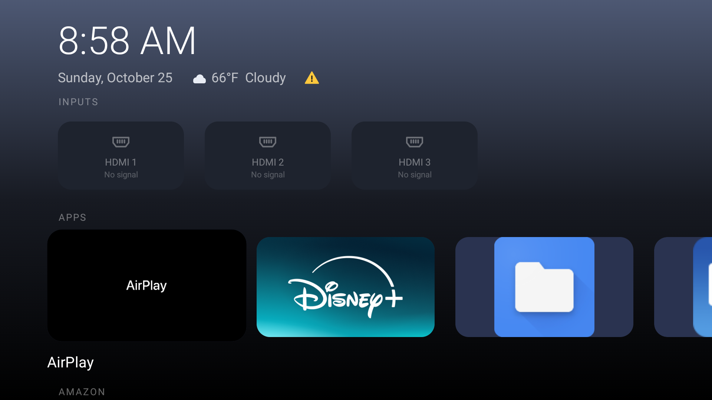
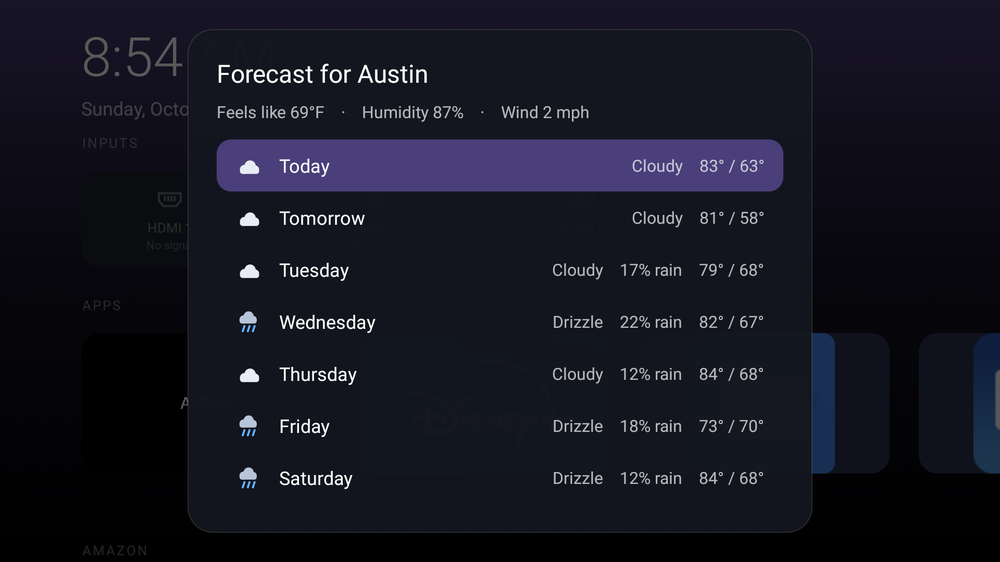
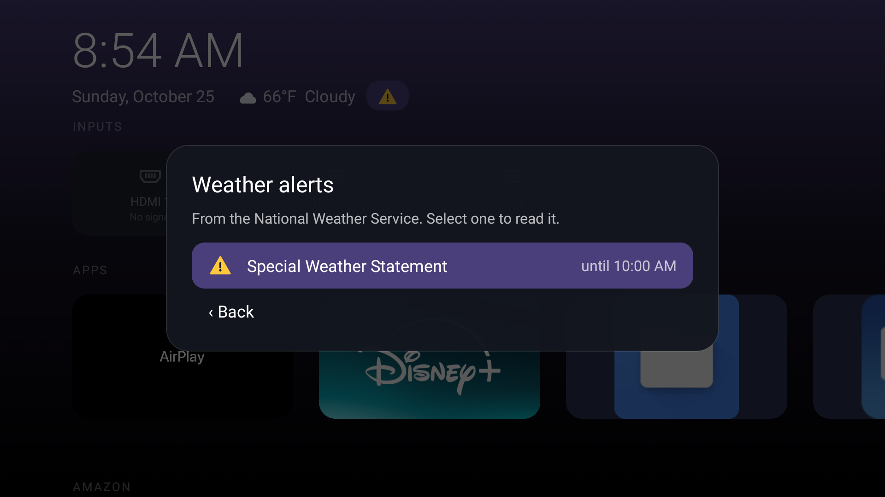
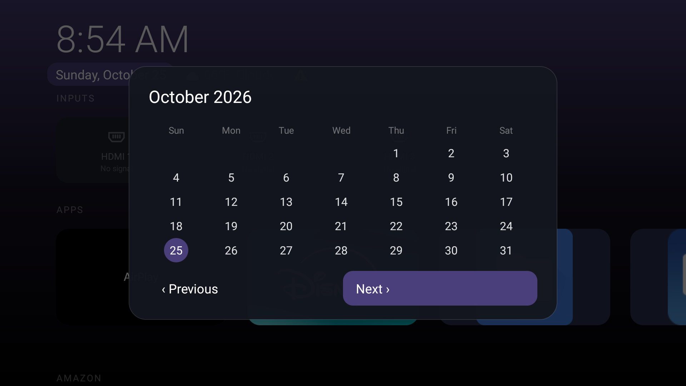
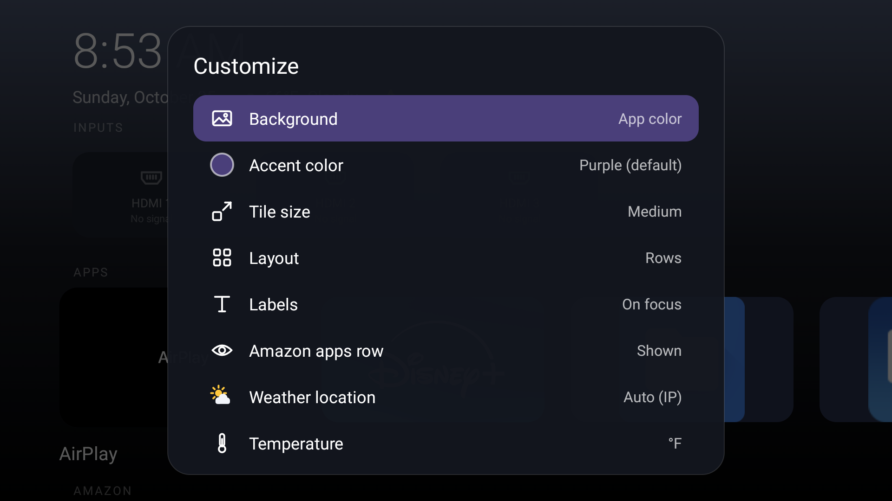
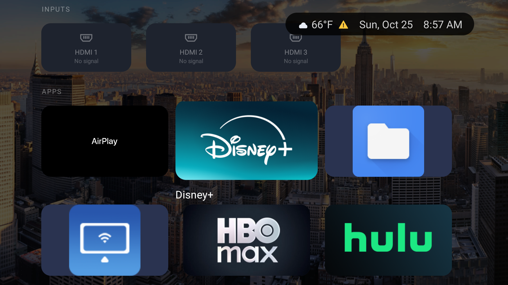
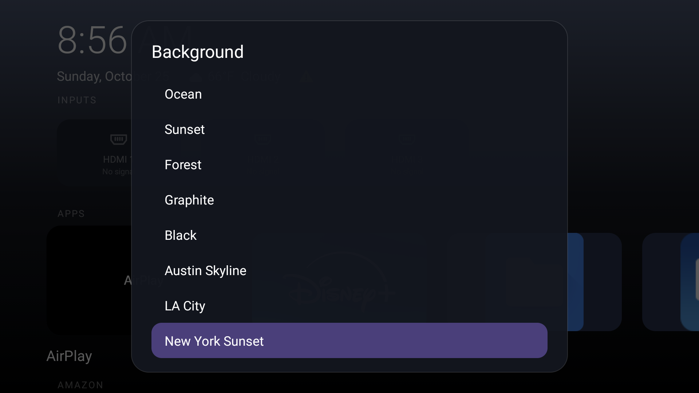
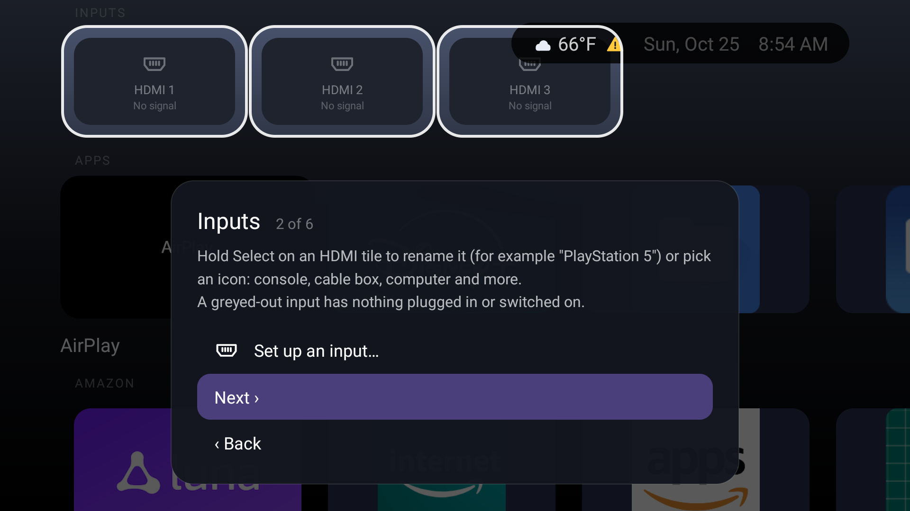

# Fast Home

A replacement home screen for Amazon Fire TV. It shows your apps, HDMI inputs and settings in rows of tiles, with the time and weather on top, and none of Amazon's ads, rotating banners or autoplaying previews.



It's two small APKs built with a shell script, no Android Studio:

- `fasthome.apk` (about 2 MB, most of it the three bundled photos) is the launcher.
- `fasthome-redirect.apk` (21 KB) is optional. It makes the remote's Home button open Fast Home instead of Amazon's home screen.

Tested on one device: a Fire TV smart TV (model AFTOLCBC82) running Fire OS 8.1.8.0, which is Android 11. Fire Sticks and the Fire TV Cube should work, but nobody has tried them yet.

## What it does

### Apps

Every installed app gets a tile with its banner art. Hold Select on a tile to pin it to Favorites, move it left or right, hide it, or open its Android info page. Amazon's own apps get a separate row you can hide. Prime Video and YouTube stay with your other apps.

### Inputs

HDMI ports show as tiles you can rename ("PlayStation 5") and give an icon. A port with nothing switched on is greyed out and says "No signal". Selecting an input plays it full screen inside Fast Home; Amazon's Live TV app tends to open its last channel instead of the input you picked. Fire Sticks have no HDMI inputs, so the row doesn't appear there.

### Weather

The current temperature and conditions sit under the clock. Press Up to reach the date, weather and alert icons, then Select:

- the date opens a month calendar,
- the weather opens a 7-day forecast with feels-like temperature, humidity and wind,
- the triangle (US only) lists active National Weather Service alerts. It's white, yellow or red depending on the worst alert's severity, and it only appears when there is one.

| Forecast | Weather alerts | Calendar |
|---|---|---|
|  |  |  |

### Customize

Press the Menu button (☰) on the remote.



- Background: "App color" takes its color from whichever app you're on. There are also six fixed gradients, black, and any photo you put in `launcher/assets/`.
- Accent color for menu highlights and the Customize tile, from a list or a hex code.
- Tile size, rows or grid layout, and app names always shown or only on focus.
- Weather location (automatic from your IP address, or a city you type) and °F or °C.
- A quiet tick sound as you move between tiles, which you can turn off.
- Hidden apps, to bring back the ones you hid, one at a time.
- About, and two kinds of reset: appearance only, or everything.

| Photo background, grid layout | Background picker |
|---|---|
|  |  |

### Setup guide

On first launch a six-step guide walks through the remote, inputs, colors, app order and layout. Steps about specific tiles dim everything else and outline those tiles. You can reopen it from Customize.



## Install

You need `adb` on a computer and ADB debugging turned on in the TV's Developer options (Settings › My Fire TV › Developer options).

```sh
adb connect <tv-ip>:5555
adb install -r fasthome.apk
```

Fast Home now shows up in your app list. To make the Home button open it, also install the helper:

```sh
adb install -r fasthome-redirect.apk
adb shell pm grant fast.home.redirect android.permission.READ_LOGS   # optional, makes Home about 0.4 s faster
```

Then turn on **Fast Home: Home button** in Settings › Accessibility. Grant the permission before you turn it on, because it only takes effect when the helper starts. Install `fasthome.apk` first, since the helper uses a permission that the launcher defines.

### How the Home button helper works, and its limits

Fire OS handles the Home button itself, before any app can see it, and it doesn't let you replace or disable Amazon's launcher. So the helper waits for Amazon's home screen to start opening, then immediately opens Fast Home on top of it. With the log permission it notices about 380 ms before Amazon's screen is drawn. Without it, the helper falls back to the accessibility event, which only arrives once Amazon's screen is already visible. During the switch it shows a cover that looks like Fast Home's background and clock, so you don't see Amazon's screen flash.

Amazon's launcher is a protected system app, so it keeps running in the background either way. To go back to Amazon's home screen, turn the helper off in Settings › Accessibility, or uninstall it.

## Network and privacy

Fast Home has no accounts, ads or analytics. It talks to four services, all for the weather:

- `ipwho.is`, to find the TV's approximate location from its IP address. Skipped if you type in a city.
- `geocoding-api.open-meteo.com`, to look up a city you typed.
- `api.open-meteo.com`, for current weather and the forecast.
- `api.weather.gov`, for weather alerts (US only).

It refreshes every 10 minutes while the home screen is open.

## Performance

Measured on the same TV (AFTOLCBC82, Fire OS 8.1.8.0) on October 25, 2026, back to back, with Fast Home on default settings. Before testing, 24 Amazon packages (shopping, telemetry, demo content and similar) had been disabled with `pm disable-user`. That applied to both runs, so it doesn't favor either launcher. Times are the median of 5 runs.

| | Stock Amazon launcher | Fast Home |
|---|---|---|
| Home button, from the first on-screen change until the screen stops changing | 1,332 ms | 702 ms |
| Switching back to the home screen while it's already running | 239 ms | 108 ms |
| Cold start | not measurable (see below) | 1,004 ms |
| Memory used by the home screen (PSS) | 202 MB | 53 MB |
| Free memory on the TV (MemAvailable) | 585 MB | 705 MB |
| CPU used by the launcher while sitting on the home screen for 30 s | 25% of one core | 0% |
| Whole TV busy over those 30 s | 16% | 6% |
| Frame time while moving through tiles (median / 90th / 99th percentile) | 27 / 97 / 300 ms | 17 / 29 / 38 ms |
| Frames that missed their deadline during the same moves | 83% | 53% |
| APK size | 26.7 MB | 1.9 MB, plus 21 KB for the helper |

What these numbers mean, and what they don't:

- The Home button row includes the helper's work. Fire OS still starts Amazon's home screen first, and the helper switches to Fast Home on top of it.
- Amazon's launcher is a protected app. Fire OS won't stop or kill it, so it has no cold start to measure. It also keeps running behind Fast Home, where it used 135 MB during the Fast Home run. The free-memory row already includes that.
- Fast Home's frames aren't perfect. A 60 Hz screen needs a frame every 16.7 ms, and Fast Home's median of 17 ms sits right at that line, so about half its frames during scrolling ran late. The difference is in the slow frames: its worst 1% took 38 ms, against 300 ms for the stock launcher.
- This is one TV and five runs per test. Expect different numbers on other models.

`docs/bench.sh` runs every test above. It needs `adb` and `ffmpeg`, and takes about 6 minutes. The raw output from this run is in `docs/benchmarks-2026-10-25.txt`.

## Build

`launcher/build.sh` compiles both APKs with `javac`, `d8` and `aapt2`. It expects:

- JDK 17 at `/opt/homebrew/opt/openjdk@17` (Homebrew on macOS),
- the Android SDK at `~/android-sdk` with build-tools 30.0.3 and platform 30,
- `ffmpeg` (optional) to shrink background photos to 1920×1080,
- a `launcher/debug.keystore` (password `android`) to sign with. It's kept out of git, so make your own: `keytool -genkeypair -keystore launcher/debug.keystore -storepass android -keypass android -alias key -keyalg RSA -dname CN=debug -validity 10000`.

```sh
launcher/build.sh   # writes launcher/out/fasthome.apk and launcher/out/fasthome-redirect.apk
```

The version number is the build date. Edit the paths at the top of `build.sh` if your SDK or JDK lives elsewhere.

### Layout

```
launcher/
  src/fast/Home.java           the home screen, menus, weather
  src/fast/InputActivity.java  full-screen HDMI input
  src/fast/HomeRedirect.java   the Home-button helper (separate APK)
  src/fast/Ui.java             icons, header and gradient shared by both APKs
  AndroidManifest.xml          launcher manifest
  redirect/                    helper manifest and resources
  assets/                      background photos
docs/
  bench.sh                     the benchmark script
  screenshots/
```
